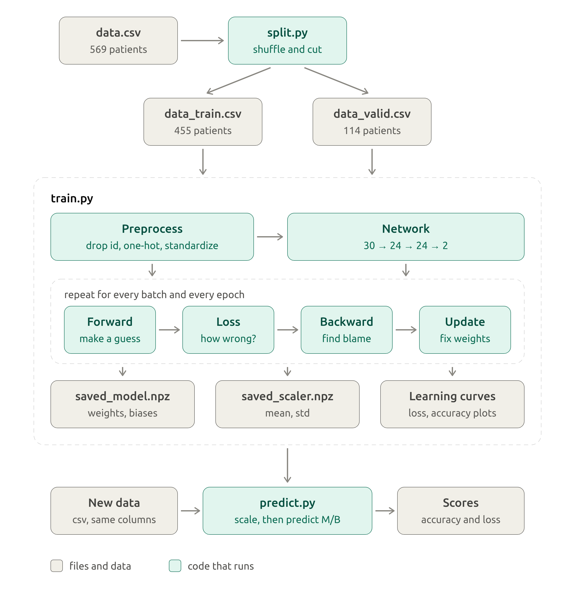

# multilayer-perceptron

A multilayer perceptron (MLP) written from scratch in Python with NumPy (no ML frameworks). It classifies breast tumours as **benign (B)** or **malignant (M)** using the Wisconsin Diagnostic Breast Cancer dataset (`data.csv`).

The project covers every step of the pipeline: splitting the data, preprocessing, the forward pass, backpropagation, gradient descent and Adam, early stopping, saving and loading the model, prediction, and evaluation.



## Features

- Fully connected layers with **sigmoid** hidden activations and a **softmax** output
- **He-uniform** weight initialisation
- **Categorical cross-entropy** loss for training; **binary cross-entropy** reported at prediction time
- Mini-batch training with **gradient descent** or **Adam**
- **Early stopping** (`--patience`) that restores the best weights
- Metrics computed every epoch: loss, accuracy, precision, recall, F1
- Learning-curve plots, plus a script that compares several training runs
- Model and scaler saved as `.npz` files so they can be reloaded for prediction

## Requirements

- Python 3
- `numpy`, `pandas`, `matplotlib`

```bash
pip install numpy pandas matplotlib
```

## Dataset

`data.csv` has no header. Each row is:

| Column | Content |
|---|---|
| 1 | Sample ID |
| 2 | Diagnosis: `M` (malignant) or `B` (benign) |
| 3–32 | 30 real-valued features computed from a cell-nucleus image |

Labels are one-hot encoded: `B → [1, 0]`, `M → [0, 1]`. Features are standardised (z-score) using the mean and standard deviation of the training set only.

## Usage

### 1. Split the dataset

```bash
python3 split.py
```

This shuffles `data.csv` with a fixed seed and writes `data_train.csv` (80%) and `data_valid.csv` (20%).

| Option | Default | Description |
|---|---|---|
| `--dataset` | `data.csv` | Input CSV |
| `--train_ratio` | `0.8` | Fraction of rows used for training |
| `--seed` | `42` | Shuffle seed |
| `--out_train` | `data_train.csv` | Training output |
| `--out_valid` | `data_valid.csv` | Validation output |

`evaluation.py` is the split script supplied with the subject. It writes `data_training.csv` and `data_test.csv` (75/25, random shuffle).

### 2. Train

```bash
python3 train.py --layer 24 24 --epochs 100 --batch_size 8 --learning_rate 0.0314
```

Example output:

```
x_train shape : (455, 30)
x_valid shape : (114, 30)
layer sizes : [30, 24, 24, 2]
activations : ['sigmoid', 'sigmoid', 'softmax']
epoch 1/100 - loss: ... - val_loss: ... - acc: ... - val_acc: ... - precision: ... - recall: ... - f1: ...
...
> saving model 'saved_model.npz' to disk...
```

| Option | Default | Description |
|---|---|---|
| `--train` / `--valid` | `data_train.csv` / `data_valid.csv` | Input datasets |
| `--layer` | `24 24` | Hidden-layer sizes (at least two layers) |
| `--epochs` | `100` | Maximum number of epochs |
| `--batch_size` | `8` | Mini-batch size |
| `--learning_rate` | `0.0314` | Learning rate |
| `--optimizer` | `gradient_descent` | `gradient_descent` or `adam` |
| `--patience` | off | Early-stopping patience, in epochs |
| `--seed` | random | Seed for weight initialisation and shuffling |
| `--out_model` | `saved_model.npz` | Saved network |
| `--out_scaler` | `saved_scaler.npz` | Saved mean/std used for scaling |
| `--out_history` | `history.csv` | Per-epoch metrics |
| `--no_plot` | off | Save `learning_curves.png` without opening a window |

Training produces `saved_model.npz`, `saved_scaler.npz`, `history.csv` and `learning_curves.png`.

### 3. Predict and evaluate

```bash
python3 predict.py --dataset data_valid.csv --model saved_model.npz --scaler saved_scaler.npz
```

This prints the accuracy, binary cross-entropy, precision, recall, F1 and the confusion counts (TP/FP/TN/FN, with malignant as the positive class).

### 4. Compare runs (optional)

`compare.py` plots the validation loss and validation accuracy from several `history.csv` files on one figure:

```bash
for lr in 0.01 0.0314 0.1; do
    python3 train.py --patience 10 --no_plot --learning_rate $lr \
        --out_history history_lr$lr.csv --out_model model_lr$lr.npz
done

python3 compare.py history_lr0.01.csv history_lr0.0314.csv history_lr0.1.csv \
    --labels "lr 0.01" "lr 0.0314" "lr 0.1" --out compare_learning_rates.png
```

The docstring at the top of [compare.py](compare.py) has more examples, including Adam learning rates and Adam vs. gradient descent.

## Project structure

| File | Role |
|---|---|
| [activations.py](activations.py) | Sigmoid, its derivative, and a numerically stable softmax |
| [layers.py](layers.py) | `DenseLayer`: forward and backward passes, gradient-descent and Adam updates, He initialisation |
| [network.py](network.py) | `Network`: training loop, early stopping, save/load, loss and metric functions |
| [preprocessing.py](preprocessing.py) | Loading the CSV, label encoding, standardisation, saving the history |
| [split.py](split.py) | Train/validation split |
| [train.py](train.py) | Training CLI and learning-curve plots |
| [predict.py](predict.py) | Loads a saved model and evaluates it on a dataset |
| [compare.py](compare.py) | Plots several training histories together |
| [evaluation.py](evaluation.py) | Split script supplied with the subject |
| `mlp.pdf`, `Intra Projects multilayer-perceptron Edit.pdf` | Subject and project documents |

## How it works

1. **Forward pass:** each layer computes `a = f(x·W + b)`. Hidden layers use the sigmoid; the output layer uses softmax to produce class probabilities.
2. **Loss:** categorical cross-entropy, `E = -mean(Σ y·log(p))`.
3. **Backward pass:** with softmax and cross-entropy together, the output gradient simplifies to `p - y`. It is propagated backwards through each layer using the chain rule and the sigmoid derivative `a(1 - a)`.
4. **Update:** either plain gradient descent (`W -= lr·∇W`) or Adam (bias-corrected first and second moment estimates, β₁ = 0.9, β₂ = 0.999).
5. **Early stopping:** if the validation loss has not improved for `patience` epochs, training stops and the best weights are restored.

## References

- [What is a Multilayer Perceptron (MLP)? (aiml.com)](https://aiml.com/what-is-a-multilayer-perceptron-mlp/)
- [Breast Cancer Wisconsin (Diagnostic) dataset (UCI)](https://archive.ics.uci.edu/dataset/17/breast+cancer+wisconsin+diagnostic)
